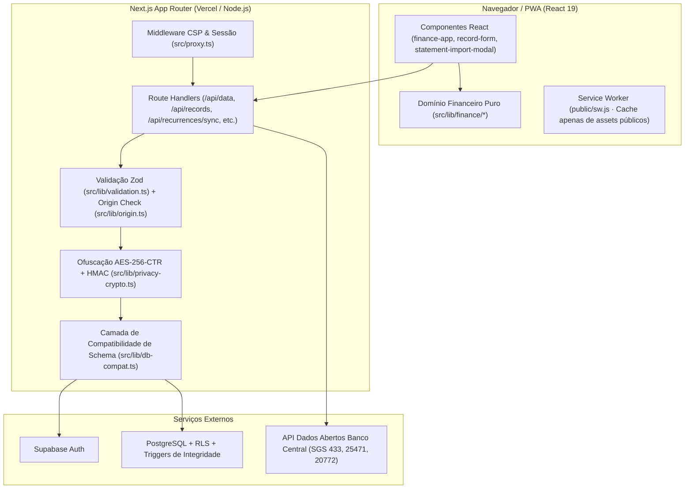
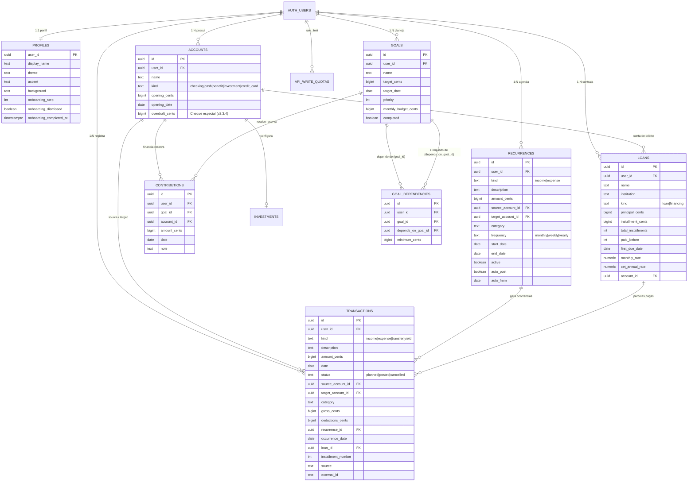

# Documentação Técnica e Funcional Completa — Meu Norte (`v3.0.3`)

> **Fase 3.0.3:** este documento descreve majoritariamente a arquitetura da base 3.0.2. As correções incrementais de importação, sua implementação, verificações e limitações estão registradas em [FASE-3.0.3.md](FASE-3.0.3.md). O comportamento vigente deve ser confirmado no código.

> **Propósito deste documento:** servir como referência única e completa de engenharia, produto, regras de negócio, banco de dados e segurança do **Meu Norte (`Gerenciador-Financeiro-Pessoal`)**. Qualquer pessoa desenvolvedora, analista ou auditora que assumir o código encontrará aqui o funcionamento integral do sistema de ponta a ponta.

---

## Sumário

1. [Visão Geral do Projeto](#1-visão-geral-do-projeto)
2. [Stack Tecnológica e Dependências](#2-stack-tecnológica-e-dependências)
3. [Arquitetura e Estrutura de Diretórios](#3-arquitetura-e-estrutura-de-diretórios)
4. [Requisitos Funcionais (RF)](#4-requisitos-funcionais-rf)
5. [Requisitos Não Funcionais (RNF)](#5-requisitos-não-funcionais-rnf)
6. [Regras de Negócio e Fórmulas Financeiras (RN)](#6-regras-de-negócio-e-fórmulas-financeiras-rn)
7. [Modelo de Dados, Esquema Relacional e Migrações](#7-modelo-de-dados-esquema-relacional-e-migrações)
8. [Rotas de API e Contratos de Backend](#8-rotas-de-api-e-contratos-de-backend)
9. [Componentes de Interface e Experiência do Usuário (UX)](#9-componentes-de-interface-e-experiência-do-usuário-ux)
10. [Segurança, Privacidade (LGPD) e Criptografia](#10-segurança-privacidade-lgpd-e-criptografia)
11. [Suíte de Testes e Qualidade](#11-suíte-de-testes-e-qualidade)
12. [Guia de Instalação, Variáveis de Ambiente e Deploy](#12-guia-de-instalação-variáveis-de-ambiente-e-deploy)

---

## 1. Visão Geral do Projeto

O **Meu Norte** é um gerenciador financeiro pessoal web e **Progressive Web App (PWA)** voltado para a realidade financeira brasileira (BRL em centavos, separação entre saldo livre e benefícios VA/VR, cheque especial, faturas de cartão de crédito e carteiras digitais parceladas, importação inteligente de extratos/faturas com conciliação anti-duplicidade, desafios de poupança e simulador de decisões de compra/aluguel).

### Princípios Fundamentais de Projeto
1. **Exatidão Monetária Absoluta:** nenhum valor monetário utiliza ponto flutuante nativo (`parseFloat`) para somas ou saldos. Todos os valores trafegam e são armazenados como **inteiros em centavos (`bigint` no PostgreSQL / `safe integer` no TypeScript)**, usando `Decimal.js` com arredondamento `ROUND_HALF_UP` para cálculos de juros, amortizações e índices.
2. **Separação Estrita entre Realizado e Previsto:** lançamentos futuros ou agendados (`status = 'planned'`) e cancelados (`status = 'cancelled'`) **jamais** alteram o saldo atual das contas. Somente lançamentos confirmados (`status = 'posted'`) até a data de referência entram no cálculo do saldo.
3. **Saldos Derivados (Ledger Imutável por Soma):** o saldo de uma conta nunca é uma coluna mutável sobrescrita por `UPDATE`. Ele é sempre derivado deterministicamente de `opening_cents + entradas_realizadas - saídas_realizadas`.
4. **Aportes como Reservas Vinculadas (Sem Dupla Contagem):** guardar dinheiro para uma meta (`Contribution`) não cria dinheiro novo nem registra uma despesa que some do patrimônio — ele **reserva** uma fração do saldo real de uma conta elegível, reduzindo apenas o **Dinheiro Livre**.
5. **Isolamento Multi-inquilino (Multi-tenant) no Banco:** todas as tabelas possuem `user_id`, políticas de **Row Level Security (RLS)** baseadas em `auth.uid()` e chaves estrangeiras compostas `(user_id, id)` que impedem vínculos cruzados entre usuários até mesmo via chamadas diretas à API.

---

## 2. Stack Tecnológica e Dependências

| Camada | Tecnologia | Versão / Detalhes |
| :--- | :--- | :--- |
| **Framework Web** | Next.js (App Router) | `16.4.2` (SSR, Route Handlers, Middleware/Proxy CSP) |
| **Biblioteca UI** | React / React DOM | `19.2.0` |
| **Linguagem** | TypeScript | `^5.9.3` (`strict: true`) |
| **Estilização** | CSS Customizado + Tailwind CSS | `@tailwindcss/postcss ^4.2.0`, variáveis de tema em `globals.css` e `phase2.css` |
| **Autenticação e BaaS** | Supabase (`@supabase/ssr`, `@supabase/supabase-js`) | `0.12.7` / `^2.99.0` (Cookies HTTP-only / SSR) |
| **Banco de Dados** | PostgreSQL (Supabase) | Triggers transacionais PL/pgSQL, RLS, `pg_cron` opcional |
| **Matemática Financeira** | `decimal.js` | `^10.6.0` (Precisão de 28 dígitos, `ROUND_HALF_UP`) |
| **Validação de Contratos** | `zod` | `^4.3.0` (Schemas estritos no cliente e no servidor) |
| **Ícones** | `lucide-react` | `^0.577.0` |
| **Testes Automatizados** | Vitest + Testing Library + PGlite | `vitest ^4.1.2`, `@electric-sql/pglite` (PostgreSQL real em memória para testes de banco/RLS) |

---

## 3. Arquitetura e Estrutura de Diretórios



### Mapa Completo de Arquivos do Repositório

```text
Gerenciador-Financeiro-Pessoal/
├── docs/                                  # Documentações históricas, guias de fase e segurança
│   ├── DOCUMENTACAO-COMPLETA.md           # Esta documentação completa do sistema
│   ├── ESPECIFICACAO.md                   # Especificação original da Fase 1 (MVP)
│   ├── MODELO.md                          # Modelo relacional base
│   ├── SEGURANCA.md                       # Matriz de controles de segurança (ISO 27001/27002 ref)
│   ├── USABILIDADE-E-PRIVACIDADE.md       # Análise de UX, LGPD Beta e desenho E2EE futuro
│   ├── VALIDACAO.md                       # Registro de evidências de validação
│   └── FASE-*.md                          # Roteiros incrementais de atualização de banco/versão
├── public/                                # Ativos estáticos públicos e PWA
│   ├── fonts/geist-variable.ttf           # Fonte Geist variável local (sem dependência de Google Fonts)
│   ├── icon.svg / apple-icon.svg          # Ícones vetoriais da bússola Meu Norte
│   └── sw.js                              # Service Worker com isolamento de rotas privadas
├── scripts/
│   └── smoke-supabase.mjs                 # Script opcional de smoke test contra projeto Supabase real
├── supabase/
│   ├── phase2-cron.sql                    # Agendamento diário pg_cron para sincronizar recorrências
│   └── migrations/                        # Migrações SQL versionadas e idempotentes
│       ├── 202610180001_initial.sql       # Tabelas base, RLS, FKs compostas e triggers de integridade
│       ├── 202610180002_phase2.sql        # Empréstimos (loans), auto_post em recorrências, rate limit
│       ├── 202610190003_phase22.sql       # Tema escuro ("dark") como padrão de novos perfis
│       ├── 202610220004_phase23.sql       # Dependências entre metas (goal_dependencies) e tutorial
│       ├── 202610220005_phase231.sql      # Ajuste de onboarding para contas existentes vs. novas
│       └── 202610290006_phase234.sql      # Limite de cheque especial (overdraft_cents) em contas correntes
├── src/
│   ├── proxy.ts                           # Geração de CSP com nonce por requisição + refresh de sessão
│   ├── app/                               # Rotas do Next.js App Router
│   │   ├── layout.tsx                     # Root layout, metadados PWA e aplicação de tema
│   │   ├── page.tsx                       # Landing page pública de apresentação
│   │   ├── globals.css                    # Estilos globais, tokens de cores/temas e estilos v3.0
│   │   ├── phase2.css                     # Estilos de modais responsivos, animações e componentes v2/v3
│   │   ├── manifest.ts                    # Web App Manifest dinâmico do PWA
│   │   ├── entrar/page.tsx                # Tela de Login, Cadastro e orientação de senha
│   │   ├── privacidade/page.tsx           # Aviso público de privacidade, LGPD e transparência Beta
│   │   ├── offline/page.tsx               # Fallback amigável quando sem conexão
│   │   ├── demo/page.tsx                  # Rota de demonstração 100% em memória (/demo)
│   │   ├── app/page.tsx                   # Área logada principal (verifica sessão no servidor)
│   │   └── api/                           # Endpoints REST/RPC internos
│   │       ├── auth/route.ts              # Login, cadastro, logout e troca de senha
│   │       ├── data/route.ts              # Leitura paginada completa do estado do usuário + perfil
│   │       ├── records/route.ts           # CRUD genérico autenticado e validado por entidade
│   │       ├── recurrences/sync/route.ts  # Materialização idempotente de ocorrências recorrentes
│   │       ├── loans/pay/route.ts         # Pagamento atômico de parcela de contrato
│   │       ├── account/delete/route.ts    # Exclusão completa da conta mediante confirmação de senha
│   │       └── indicators/
│   │           ├── ipca/route.ts          # Consulta acumulada 12 meses do IPCA (BCB SGS 433)
│   │           └── credit/route.ts        # Consulta de juros médios de veículos/imóveis (BCB SGS 25471/20772)
│   ├── components/                        # Componentes React de interface
│   │   ├── finance-app.tsx                # Orquestrador principal das abas, estado, modais e ações
│   │   ├── record-form.tsx                # Modal de criação/edição de todas as entidades
│   │   ├── statement-import-modal.tsx     # Modal v3.0.2 de importação de extratos/faturas e conciliação
│   │   ├── purchase-simulator.tsx         # Simulador "Cabe no meu bolso?" (compras, financiamentos e aluguel)
│   │   ├── piggy-bank-board.tsx           # Cartela interativa do Desafio do Cofrinho (1 a N)
│   │   ├── onboarding-guide.tsx           # Guia passo a passo persistido por usuário
│   │   ├── auth-form.tsx                  # Formulário de autenticação com tratamento de e-mail duplicado
│   │   ├── date-control.tsx               # Calendário customizado (DateControl) e seletor de mês (MonthControl)
│   │   ├── select-control.tsx             # Lista suspensa customizada acessível por teclado
│   │   ├── use-calendar-position.ts       # Hook de posicionamento inteligente de popovers e listas suspensas
│   │   ├── money-input.tsx                # Input monetário com máscara brasileira (R$ x.xxx,xx)
│   │   ├── brand-mark.tsx                 # Ícone animado da bússola Meu Norte
│   │   └── sw-register.tsx                # Registro seguro do Service Worker no cliente
│   └── lib/                               # Núcleo de domínio, utilitários e integrações
│       ├── types.ts                       # Tipagens TypeScript de todas as entidades do sistema
│       ├── version.ts                     # Constante central de versão (APP_VERSION = "3.0.3")
│       ├── validation.ts                  # Schemas Zod de todas as entidades e payloads de API
│       ├── origin.ts                      # Proteção CSRF/Origin e leitura de body com limite de bytes
│       ├── db-compat.ts                   # Fallback automático para colunas opcionais no banco
│       ├── privacy-crypto.ts              # Ofuscação/desofuscação AES-256-CTR + HMAC por usuário
│       ├── csv.ts                         # Gerador de CSV com proteção contra Formula Injection
│       ├── categories.ts                  # Categorias padrão de receitas e despesas
│       ├── demo.ts                        # Estado e mutações em memória para o modo /demo
│       ├── bcb.ts                         # Cliente servidor para séries do Banco Central (SGS)
│       ├── supabase/                      # Clientes Supabase (browser.ts, server.ts, env.ts)
│       └── finance/                       # Motor de Regras de Negócio Financeiras (Funções Puras)
│           ├── money.ts                   # Aritmética segura em centavos e parser monetário BR
│           ├── dates.ts                   # Manipulação de datas YYYY-MM-DD no fuso America/Sao_Paulo
│           ├── engine.ts                  # Cálculo de saldos, cheque especial, visão geral e plano de metas
│           ├── credit-cards.ts            # Faturas, ciclo de fechamento/vencimento, parcelamentos e carteiras
│           ├── statement-import.ts        # Parser OFX/CSV/Texto, categorizador e motor anti-duplicidade
│           ├── recurrence.ts              # Geração de datas recorrentes (mensal, semanal, anual/bissexto)
│           ├── goal-dependencies.ts       # Validação de grafo acíclico (DAG) e bloqueadores de metas
│           ├── piggy-bank.ts              # Matemática do Desafio do Cofrinho (1 a N) e Cofrinho Progressivo
│           ├── loans.ts                   # Cronograma de contratos, Valor Presente e simulação de amortização
│           ├── purchase.ts                # Motor do simulador "Cabe no meu bolso?" (Price, SAC e Aluguel)
│           └── reports.ts                 # Raio-X mensal, comparativos, médias e histórico de 12 meses
└── tests/                                 # 15 suítes de testes automatizados (187 testes)
```

---

## 4. Requisitos Funcionais (RF)

### RF01 — Identidade, Autenticação e Ciclo de Vida da Conta
- **RF01.1 (Cadastro):** permite criar conta informando Nome, E-mail e Senha (mínimo de 8 caracteres, máximo de 72). Quando `NEXT_PUBLIC_AUTH_EMAIL_ENABLED=false`, o sistema cria o usuário via Supabase Auth, encerra qualquer sessão automática imediata e redireciona para a aba **Entrar** com o e-mail já preenchido para validar o fluxo de login.
- **RF01.2 (Detecção de E-mail Existente):** caso o usuário tente cadastrar um e-mail já registrado (`user_already_exists` ou `email_exists`), exibe mensagem amigável e botão **"Ir para entrar"** que preserva o e-mail digitado e limpa o campo de senha.
- **RF01.3 (Login e Logout):** autenticação por e-mail e senha com sessão mantida em cookies HTTP-only gerenciados por `@supabase/ssr`.
- **RF01.4 (Alteração de Senha):** usuários autenticados podem alterar a senha informando a senha atual (verificada no servidor antes da troca) e a nova senha.
- **RF01.5 (Exclusão Total de Conta):** em **Preferências**, o usuário pode apagar definitivamente sua conta e todos os seus dados financeiros mediante digitação da senha atual e da palavra de confirmação `APAGAR`. A operação utiliza `SUPABASE_SECRET_KEY` exclusivamente no servidor.

### RF02 — Tutorial Interativo de Primeiros Passos (Onboarding)
- **RF02.1 (Guia em Etapas):** orienta novos usuários (ou usuários que desejarem rever o guia) através das etapas:
  1. Cadastrar contas, cartões ou carteiras com saldo/limite inicial;
  2. Importar extratos/faturas prontos **ou** cadastrar receitas e despesas recorrentes;
  3. Registrar contratos de empréstimos/financiamentos em andamento;
  4. Conhecer a tela de Lançamentos (`Para confirmar`), Metas e Simulador de Compras.
- **RF02.2 (Persistência no Perfil):** o passo atual (`onboarding_step`), o adiamento (`onboarding_dismissed`) e a data de conclusão (`onboarding_completed_at`) são salvos na tabela `profiles`.

### RF03 — Gestão de Contas, Cheque Especial, Cartões e Carteiras Digitais
- **RF03.1 (Tipos de Conta):** suporta 5 naturezas de conta (`AccountKind`):
  - `checking`: Conta Corrente / Conta Digital;
  - `cash`: Dinheiro físico / Carteira;
  - `investment`: Dinheiro Guardado / Reserva / Aplicação;
  - `benefit`: Vale-Alimentação / Vale-Refeição (`VA/VR`);
  - `credit_card`: Cartão de Crédito ou Carteira de Crédito Digital (ex.: *SPayLater / Shopee*, *Mercado Crédito*, *Crediário*, *Carnê*).
- **RF03.2 (Limite de Cheque Especial em Conta Corrente):** contas do tipo `checking` permitem habilitar e configurar `overdraft_cents` (Limite do Cheque Especial), exibindo barra de consumo, percentual utilizado, valor comprometido e limite restante.
- **RF03.3 (Situação Inicial do Saldo):** ao criar/editar conta corrente, permite indicar se o saldo de abertura é positivo (`+`) ou se a conta já inicia utilizando o cheque especial (`-`).

### RF04 — Gestão de Faturas de Cartão de Crédito e Carteiras de Crédito
- **RF04.1 (Configuração de Ciclo):** cada cartão/carteira define instituição, limite total (`credit_limit_cents`), dia de vencimento (`due_day`, 1 a 31) e dia de fechamento (`closing_day`, 1 a 31).
- **RF04.2 (Compras à Vista e Parceladas no Crédito):** despesas lançadas em cartão podem ser parceladas em até `120x`, gerando automaticamente as parcelas numeradas (`1/N` a `N/N`) nos respectivos meses de vencimento de cada fatura com metadados estruturados no campo `external_id` (`cc:<groupId>:<num>/<total>:<purchaseDate>:<dueDate>`).
- **RF04.3 (Pagamento de Fatura):** permite pagar a fatura aberta do mês (integral ou parcialmente), gerando uma transferência/baixa da conta pagadora escolhida e marcando os itens da fatura como `posted` (liberando o limite do cartão).
- **RF04.4 (Antecipação de Parcelas):** permite selecionar parcelas de faturas futuras (`planned`) e antecipá-las para a fatura atual (ou quitá-las com desconto opcional), recalculando imediatamente o limite disponível.

### RF05 — Lançamentos Financeiros e Folha Salarial
- **RF05.1 (Tipos de Movimento):**
  - `income` (Receita): entrada de recursos em uma conta destino (`target_account_id`);
  - `expense` (Despesa): saída de recursos de uma conta origem (`source_account_id`) ou compra em cartão de crédito;
  - `transfer` (Transferência): movimentação atômica entre duas contas distintas de mesma natureza de restrição (`source_account_id` → `target_account_id`);
  - `yield` (Rendimento): resultado positivo ou negativo aplicado exclusivamente a uma conta do tipo `investment` (Dinheiro Guardado).
- **RF05.2 (Detalhamento Salarial):** receitas na categoria `Salário` permitem informar opcionalmente o Salário Bruto (`gross_cents`) e Total de Descontos (`deductions_cents`), validando `gross_cents - deductions_cents = amount_cents` (líquido).
- **RF05.3 (Filtros e Busca):** filtragem por mês de competência, tipo de movimento, status (`posted` / `planned`), conta e busca textual por descrição ou categoria.

### RF06 — Importação Inteligente de Extratos e Faturas (`v3.0.2`)
- **RF06.1 (Abertura Direta do Explorador / Galeria):** ao clicar em **"Importar extrato / fatura"**, o app aciona imediatamente o seletor nativo de arquivos do sistema operacional (Explorador de Arquivos no PC; opção de **Fotos ou Arquivos** no celular) e abre o modal de importação.
- **RF06.2 (Formatos Suportados):**
  - Arquivos `.OFX` e `.QFX` (extrato bancário e fatura de cartão no padrão Open Financial Exchange);
  - Arquivos `.CSV` e `.TXT` (separados por `;`, `,` ou tabulação, com detecção automática de colunas de data, descrição, valor e identificador);
  - Arquivos `.PDF` (extração automática de linhas de texto legíveis no próprio navegador);
  - Imagens/Prints de tela (`.PNG`, `.JPG`, `.WEBP`, `.HEIC` — exibe pré-visualização do comprovante/fatura anexado junto à área de colagem/conferência);
  - Colagem direta de texto copiado do aplicativo do banco ou PDF.
- **RF06.3 (Higienização e Categorização Automática):** remove prefixos bancários ruidosos (`COMPRA CARTAO DEBITO`, `PIX ENVIADO -`, `PAGAMENTO PIX`, etc.) e classifica cada lançamento automaticamente em uma das categorias do app com base em dicionário de palavras-chave brasileiras (`iFood`, `Uber`, `Carrefour`, `Netflix`, `Enel`, `Sabesp`, `Shopee`, `Salário`, etc.).
- **RF06.4 (Projeção Automática de Parcelas Futuras na Fatura):** ao importar uma fatura de cartão contendo compras parceladas (ex.: `Shopee *Kit Casa 01/03`), oferece a opção de projetar automaticamente as parcelas restantes (`02/03` e `03/03`) nas faturas dos meses seguintes.
- **RF06.5 (Conciliação Anti-Duplicidade em 3 Níveis):** antes de importar, cruza cada linha do arquivo com os lançamentos já existentes do usuário, desmarcando automaticamente duplicatas exatas, possíveis lançamentos manuais já feitos e pagamentos internos de fatura, permitindo revisão linha a linha com seletores padronizados ([`SelectControl`](file:///c:/Users/jea_goncalves/Documents/JEAN/Projetos/Gerenciador-Financeiro-Pessoal/src/components/select-control.tsx)).

### RF07 — Regras de Recorrência e Sincronização
- **RF07.1 (Frequências):** suporta regras `monthly` (mensal), `weekly` (semanal) e `yearly` (anual), com data de início (`start_date`), data final opcional (`end_date`) e estado ativo/pausado (`active`).
- **RF07.2 (Fila "Para Confirmar"):** ocorrências vencidas ou com data de hoje ficam destacadas no painel **Para confirmar** em Lançamentos, oferecendo ações rápidas de **Recebi / Paguei** (1 clique), **Ajustar** (editar valor/data) ou **Pular** (marca a ocorrência como `cancelled` para nunca ser recriada).
- **RF07.3 (Registro Automático Opcional):** quando `auto_post = true`, ocorrências a partir de `auto_from` até a data atual são confirmadas automaticamente como `posted` desde que a conta possua saldo/limite suficiente.

### RF08 — Metas Financeiras, Dependências e Desafios do Cofrinho
- **RF08.1 (CRUD de Metas):** cada meta possui nome, valor-alvo (`target_cents`), data-alvo (`target_date`), prioridade (`1` a `5`), teto mensal opcional (`monthly_budget_cents`), indicador de conclusão (`completed`) e até 20 dependências (`dependencies`).
- **RF08.2 (Condições entre Metas):** uma meta pode aguardar que outra meta seja marcada como concluída (`minimum_cents = null`) ou que atinja um valor mínimo reservado (`minimum_cents > 0`).
- **RF08.3 (Desafio do Cofrinho — Cartela `1 a N`):** permite criar metas no formato de cartela numerada (ex.: `1 a 100`, `1 a 200`, `1 a 500 = R$ 125.250,00` ou qualquer tamanho de `2 a 2.000`). Exibe o componente interativo [`PiggyBankBoard`](file:///c:/Users/jea_goncalves/Documents/JEAN/Projetos/Gerenciador-Financeiro-Pessoal/src/components/piggy-bank-board.tsx) onde o usuário seleciona os números que deseja marcar, escolhe a conta de onde sairá a reserva e registra o aporte com nota rastreável (`Cofrinho #10, #25`).
- **RF08.4 (Cofrinho Mensal Progressivo):** permite criar metas baseadas em poupança mensal crescente (ex.: começar com `R$ 100,00` no 1º mês e aumentar `+R$ 50,00` a cada mês durante `N` meses), calculando automaticamente o valor-alvo total e a data final.

### RF09 — Aportes / Reservas (`Contributions`)
- **RF09.1 (Reserva Vinculada):** registra quanto do saldo real de uma conta (`checking`, `cash` ou `investment`) está separado para uma meta específica, impedindo que o total reservado em uma conta ultrapasse seu saldo positivo atual ou que os aportes de uma meta superem seu `target_cents`.

### RF10 — Planejamento Mensal de Metas
- **RF10.1 (Estratégias de Priorização):** distribui um orçamento mensal informado pelo usuário entre as metas abertas segundo 3 estratégias selecionáveis:
  - `date`: data-alvo mais próxima primeiro;
  - `term`: menor prazo restante em meses primeiro;
  - `budget`: maior prioridade (`1 → 5`) primeiro, desempatando por data-alvo.
- **RF10.2 (Reserva Guiada):** permite clicar em **"Revisar e reservar"** em qualquer linha sugerida pelo plano, preenchendo automaticamente a meta, o valor sugerido e a conta com saldo livre disponível.

### RF11 — Simulador de Decisão "Cabe no meu bolso?"
- **RF11.1 (Modos de Simulação):**
  - **"Esta compra cabe no meu bolso?" (`mode = 'purchase'`):** avalia se um preço/aluguel específico cabe no orçamento;
  - **"Até quanto posso gastar?" (`mode = 'ceiling'`):** calcula o preço máximo ou aluguel máximo compatível com a folga mensal desejada.
- **RF11.2 (Modalidades):**
  - Compra à vista / juntar antes de comprar (`cash`);
  - Compra parcelada ou financiada (`financed`) nos sistemas **Price** (parcelas fixas) ou **SAC** (amortização constante / parcelas decrescentes);
  - **Aluguel de Imóvel (`category = 'rent'`):** permite simular locação sem garantia, com **Depósito Caução** (ex.: atalho de `3x o aluguel`, tratado como custo inicial que retorna ao final do contrato) ou com **Seguro Fiança** (tratado como encargo mensal recorrente).
- **RF11.3 (Preenchimento com Dados do App e Consulta BCB):** botão **"Usar valores do meu app"** preenche renda, gastos (incluindo recorrências e parcelas de empréstimos do mês) e dinheiro disponível reais do usuário; botões de referência consultam taxas médias de financiamento de veículos (`SGS 25471`) e imóveis (`SGS 20772`) no Banco Central.
- **RF11.4 (Transformar em Meta):** converte o resultado da simulação (valor total à vista, entrada necessária ou caução + custos de mudança) diretamente em uma nova Meta Financeira.

### RF12 — Empréstimos e Financiamentos (`Loans`)
- **RF12.1 (Gestão de Contratos):** registra contratos com valor financiado opcional, valor fixo da parcela, total de parcelas (`1` a `600`), quantidade de parcelas já pagas antes de usar o app (`paid_before`), data do 1º vencimento, taxa de juros mensal e CET anual.
- **RF12.2 (Pagamento de Parcela):** o botão **Pagar parcela** registra atomicamente a despesa correspondente em Lançamentos vinculada a `(loan_id, installment_number)`.
- **RF12.3 (Simulador de Amortização Extraordinária):** calcula o saldo devedor estimado a valor presente (`presentValue`) e compara a economia de juros ao amortizar um valor extra optando por **reduzir o prazo** (número de meses restantes) ou **reduzir o valor da prestação**.

### RF13 — Relatórios, Raio-X do Orçamento e Exportação CSV
- **RF13.1 (Raio-X Mensal):** apresenta Entradas, Saídas, Resultado do Mês, Taxa de Poupança (`savingsRate`), divisão entre **Gastos Fixos** (recorrências e contratos) e **Gastos Variáveis**, Top 5 Maiores Despesas do mês, composição por categoria com barras de participação (`%`), comparativo com o mês anterior (`deltas`), médias históricas, resumo por conta (incluindo Cheque Especial) e histórico dos últimos 12 meses.
- **RF13.2 (Exportação CSV):** exporta os lançamentos filtrados em formato `.CSV` com codificação UTF-8 BOM, datas no padrão brasileiro (`DD/MM/AAAA`), valores formatados e sanitização contra fórmulas maliciosas de planilhas.

### RF14 — Personalização Visual e Acessibilidade
- **RF14.1 (Temas, Cores e Fundos):** suporta 3 modos de tema (`dark`, `light`, `system`), 8 cores de destaque (`violet`, `emerald`, `blue`, `rose`, `amber`, `teal`, `indigo`, `coral`) e 6 texturas de fundo (`plain`, `gradient`, `dots`, `aurora`, `grid`, `waves`), persistidos no banco por usuário e sincronizados com `sessionStorage` para evitar flash visual durante rascunhos.

---

## 5. Requisitos Não Funcionais (RNF)

| Código | Categoria | Especificação Técnica |
| :--- | :--- | :--- |
| **RNF01** | **Precisão Numérica** | Todos os cálculos monetários usam inteiros em centavos (`Number.isSafeInteger`) limitados a `MAX_CENTS = 999.999.999.999` (`R$ 9.999.999.999,99`). Cálculos fracionários (juros, SAC, Price, Dietz) usam `Decimal.js` (`precision: 28`, `rounding: ROUND_HALF_UP`). |
| **RNF02** | **Segurança de Isolamento (RLS)** | Nenhuma tabela de domínio pode ser lida ou modificada sem `auth.uid() = user_id`. Privilégios do papel `anon` são revogados em todas as tabelas e funções. |
| **RNF03** | **Proteção CSRF e Origin** | Todas as rotas de escrita (`POST`, `PATCH`, `DELETE`) validam estritamente o cabeçalho `Origin` contra `APP_ORIGIN` (em produção) ou origens locais permitidas (em desenvolvimento) via [`checkOrigin`](file:///c:/Users/jea_goncalves/Documents/JEAN/Projetos/Gerenciador-Financeiro-Pessoal/src/lib/origin.ts). |
| **RNF04** | **Content Security Policy (CSP)** | [`src/proxy.ts`](file:///c:/Users/jea_goncalves/Documents/JEAN/Projetos/Gerenciador-Financeiro-Pessoal/src/proxy.ts) gera um `nonce` criptográfico por requisição, aplicando `script-src 'self' 'nonce-...' 'strict-dynamic'`, `frame-ancestors 'none'`, `X-Frame-Options: DENY` e `X-Content-Type-Options: nosniff`. |
| **RNF05** | **Limites de Payload e Rate Limit** | O corpo das requisições é lido por stream ([`readJsonBody`](file:///c:/Users/jea_goncalves/Documents/JEAN/Projetos/Gerenciador-Financeiro-Pessoal/src/lib/origin.ts#L50-L92)) e abortado imediatamente se exceder **`12.000 bytes`**. O banco impõe limite de **`120 operações de escrita por minuto por usuário`** via `public.consume_write_quota()`. |
| **RNF06** | **Concorrência Transacional** | Toda modificação financeira no PostgreSQL adquire um lock transacional por usuário (`pg_advisory_xact_lock(18452, hashtext(auth.uid()::text))`), serializando escritas concorrentes e impedindo condições de corrida (race conditions) em saldos e reservas. |
| **RNF07** | **Cache Zero de Dados Privados** | Todas as respostas de APIs autenticadas utilizam `Cache-Control: private, no-store`. O Service Worker ([`public/sw.js`](file:///c:/Users/jea_goncalves/Documents/JEAN/Projetos/Gerenciador-Financeiro-Pessoal/public/sw.js)) ignora `/api/`, `/app`, `/entrar` e chamadas ao Supabase, armazenando apenas ativos estáticos públicos (`/`, `/offline`, ícones e fontes). |
| **RNF08** | **Paginação Completa no Servidor** | [`src/app/api/data/route.ts`](file:///c:/Users/jea_goncalves/Documents/JEAN/Projetos/Gerenciador-Financeiro-Pessoal/src/app/api/data/route.ts) busca registros em lotes paginados de `1.000` linhas até no máximo `50.000` registros por tabela, evitando o truncamento silencioso padrão de 1.000 linhas do PostgREST. |
| **RNF09** | **Compatibilidade Retroativa de Banco** | [`src/lib/db-compat.ts`](file:///c:/Users/jea_goncalves/Documents/JEAN/Projetos/Gerenciador-Financeiro-Pessoal/src/lib/db-compat.ts) e [`src/lib/finance/credit-cards.ts`](file:///c:/Users/jea_goncalves/Documents/JEAN/Projetos/Gerenciador-Financeiro-Pessoal/src/lib/finance/credit-cards.ts) garantem que novas colunas ou cartões de crédito funcionem mesmo que uma migração opcional ainda não tenha sido aplicada no banco remoto. |
| **RNF10** | **Responsividade e Prevenção de Perda de Dados** | Modais utilizam `<dialog>` nativos com larguras adaptativas em retângulo (até `820px` em formulários de 2 colunas e até `1140px` na prévia de importação em telas de 14"+) e **não fecham ao clicar acidentalmente fora (no backdrop)**, evitando perda de dados digitados. |
| **RNF11** | **Acessibilidade e Navegação por Teclado** | Seletores ([`SelectControl`](file:///c:/Users/jea_goncalves/Documents/JEAN/Projetos/Gerenciador-Financeiro-Pessoal/src/components/select-control.tsx)) e calendários ([`DateControl`](file:///c:/Users/jea_goncalves/Documents/JEAN/Projetos/Gerenciador-Financeiro-Pessoal/src/components/date-control.tsx)) suportam `ArrowUp`, `ArrowDown`, `Home`, `End`, `Enter`, `Escape`, retorno automático de foco ao botão acionador e posicionamento inteligente priorizando abertura para baixo ([`useCalendarPosition`](file:///c:/Users/jea_goncalves/Documents/JEAN/Projetos/Gerenciador-Financeiro-Pessoal/src/components/use-calendar-position.ts)). |
| **RNF12** | **Fuso Horário Canônico** | A data atual ("hoje") tanto no cliente/servidor TypeScript ([`today()`](file:///c:/Users/jea_goncalves/Documents/JEAN/Projetos/Gerenciador-Financeiro-Pessoal/src/lib/finance/dates.ts)) quanto nos triggers PostgreSQL (`(now() at time zone 'America/Sao_Paulo')::date`) é sempre avaliada no fuso **`America/Sao_Paulo`**. |

---

## 6. Regras de Negócio e Fórmulas Financeiras (RN)

### RN01 — Cálculo de Saldo de Conta (`balance`)
Implementado em [`src/lib/finance/engine.ts`](file:///c:/Users/jea_goncalves/Documents/JEAN/Projetos/Gerenciador-Financeiro-Pessoal/src/lib/finance/engine.ts#L6-L22) e na função SQL `check_finance_integrity()`:
- Para contas do tipo `credit_card`, o saldo patrimonial em caixa é sempre `0` (compras no cartão compõem a fatura daquele cartão, não saldo em conta bancária).
- Se `account.opening_date > asOf`, o saldo na data `asOf` é `0`.
- Caso contrário:
  $$\text{Saldo}(\text{conta}, \text{asOf}) = \text{opening\_cents} + \sum_{\substack{e \in \text{posted} \\ e.\text{date} \le \text{asOf} \\ e.\text{target} = \text{conta}}} e.\text{amount\_cents} - \sum_{\substack{e \in \text{posted} \\ e.\text{date} \le \text{asOf} \\ e.\text{source} = \text{conta}}} e.\text{amount\_cents}$$

### RN02 — Segregação de Benefícios (`VA/VR`) e Cartões de Crédito
- Contas do tipo `benefit` (`VA/VR`) e `credit_card` são segregadas dos indicadores de **Patrimônio**, **Dinheiro Livre**, **Liquidez Livre**, **Entradas do Mês** e **Saídas do Mês** do orçamento livre ([`overview`](file:///c:/Users/jea_goncalves/Documents/JEAN/Projetos/Gerenciador-Financeiro-Pessoal/src/lib/finance/engine.ts#L88-L181)).
- **Regra de Transferência:** uma transferência (`kind = 'transfer'`) só é permitida entre duas contas `benefit` **ou** entre duas contas que não sejam `benefit`. Nunca é permitido transferir saldo de `VA/VR` para conta corrente/dinheiro livre, nem reservar `VA/VR` em metas financeiras.

### RN03 — Patrimônio, Reservas e Dinheiro Livre
- **Patrimônio (`assets`):** soma dos saldos atuais (`balance`) de todas as contas exceto `benefit` e `credit_card`.
- **Total Reservado (`assigned`):** soma de todos os aportes (`contributions.amount_cents`) vinculados às metas.
- **Dinheiro Livre (`free`):**
  $$\text{Dinheiro Livre} = \text{Patrimônio} - \text{Total Reservado}$$
- **Liquidez Livre (`liquid`):** soma de $\max(0, \text{balance}(a) - \text{reserved}(a))$ apenas das contas de disponibilidade imediata (`checking` e `cash`).

### RN04 — Cobertura Obrigatória de Reservas e Restrições de Saldo Negativo
Validado em todas as escritas (cliente, API e trigger SQL):
1. Em qualquer conta `a`, a soma dos aportes vinculados a ela (`allocated`) nunca pode exceder seu saldo positivo atual:
   $$\text{allocated}(a) \le \max(\text{balance}(a), 0)$$
   Se o usuário tentar excluir uma receita, reduzir o saldo inicial ou lançar uma despesa que deixe o saldo da conta abaixo do que já está reservado para metas naquela conta, a operação é bloqueada exigindo que o usuário ajuste as reservas primeiro.
2. Contas do tipo `benefit` e `investment` **nunca** podem ficar com saldo negativo ($\text{balance} < 0$).

### RN05 — Consumo e Compensação Automática do Cheque Especial (`accountOverdraft`)
Implementado em [`src/lib/finance/engine.ts`](file:///c:/Users/jea_goncalves/Documents/JEAN/Projetos/Gerenciador-Financeiro-Pessoal/src/lib/finance/engine.ts#L43-L77) e na migração [`202610290006_phase234.sql`](file:///c:/Users/jea_goncalves/Documents/JEAN/Projetos/Gerenciador-Financeiro-Pessoal/supabase/migrations/202610290006_phase234.sql):
- Exclusivo para contas do tipo `checking` com `overdraft_cents > 0`.
- Quando despesas confirmadas (`posted`) superam o saldo da conta, o saldo passa a ser negativo ($\text{balance} < 0$). Definindo $\text{deficit} = \max(0, -\text{balance})$:
  - **Limite Utilizado (`usedCents`):** $\min(\text{overdraft\_cents}, \text{deficit})$
  - **Limite Disponível (`remainingCents`):** $\max(0, \text{overdraft\_cents} - \text{deficit})$
  - **Bloqueio de Estouro:** se $\text{balance} < -\text{overdraft\_cents}$, o lançamento é rejeitado com erro de limite excedido.
  - **Compensação Automática:** qualquer nova receita ou transferência recebida na conta abate automaticamente o saldo negativo, liberando o limite do cheque especial até que o saldo volte a ficar $\ge 0$.

### RN06 — Ciclo de Fechamento e Vencimento de Cartões e Carteiras de Crédito
Implementado em [`src/lib/finance/credit-cards.ts`](file:///c:/Users/jea_goncalves/Documents/JEAN/Projetos/Gerenciador-Financeiro-Pessoal/src/lib/finance/credit-cards.ts#L125-L149):
- Se o usuário não informar o dia de fechamento (`closing_day`), ele é derivado automaticamente do dia de vencimento (`due_day`) pela fórmula:
  $$\text{defaultClosingDay}(d) = ((d - 8 + 28) \bmod 28) + 1$$
- Para determinar a **data de vencimento da 1ª fatura** (`calculateFirstDueDate`) de uma compra feita no dia `pDay` do mês `M`:
  - **Caso 1 (`closingDay < dueDay`, ex.: fecha dia 3 e vence dia 10 do mesmo mês):**
    - Compra antes do fechamento (`pDay < closingDay`) → vence no próprio mês `M` (`+0` mês);
    - Compra no dia do fechamento ou após (`pDay >= closingDay`) → vence no mês seguinte `M + 1` (`+1` mês).
  - **Caso 2 (`closingDay >= dueDay`, ex.: fecha dia 26 do mês `M` e vence dia 5 do mês `M + 1`):**
    - Compra antes do fechamento (`pDay < closingDay`) → vence no mês `M + 1` (`+1` mês);
    - Compra no dia do fechamento ou após (`pDay >= closingDay`) → vence no mês `M + 2` (`+2` meses).

### RN07 — Limite Comprometido e Disponível do Cartão de Crédito (`creditCardSummary`)
- O **Limite em Uso (`usedCents`)** de um cartão de crédito soma:
  - Todas as compras/parcelas com `status = 'planned'` (ainda não pagas), incluindo parcelas de meses futuros (pois compras parceladas comprometem o limite total do cartão até serem pagas);
  - Assinaturas/recorrências vinculadas ao cartão apenas até o mês corrente (`invoiceMonth <= currentRealMonth`), para não descontar anos futuros de uma assinatura mensal do limite atual do cartão.
- **Limite Disponível (`availableCents`):** $\max(0, \text{limitCents} - \text{usedCents})$.

### RN08 — Identificação de Carteiras de Crédito Digitais (`isCreditWalletAccount`)
- O sistema identifica automaticamente se uma conta `credit_card` é uma **Carteira de Crédito Digital / Crediário** (como *SPayLater / Shopee*, *Mercado Crédito*, *Crediário*, *Carnê*, *Magalu*, *Casas Bahia*, *Pagaleve*, *PicPay*, *Renner*, *Riachuelo*, *C&A*, *Havan*) inspecionando seu nome e instituição ([`isCreditWalletAccount`](file:///c:/Users/jea_goncalves/Documents/JEAN/Projetos/Gerenciador-Financeiro-Pessoal/src/lib/finance/credit-cards.ts#L37-L44)) e adapta os rótulos da interface ("Carteira de crédito", "Fatura da carteira", etc.).

### RN09 — Algoritmo de Importação e Conciliação Anti-Duplicidade em 3 Níveis
Implementado em [`src/lib/finance/statement-import.ts`](file:///c:/Users/jea_goncalves/Documents/JEAN/Projetos/Gerenciador-Financeiro-Pessoal/src/lib/finance/statement-import.ts):
Ao processar um arquivo ou texto colado, cada lançamento extraído passa por 3 filtros de proteção antes de ser marcado para importação:
1. **Nível 1 — Pagamento Interno de Fatura (`invoice_payment`):**
   - Linhas como `PAGAMENTO RECEBIDO`, `PAGAMENTO DE FATURA`, `DEBITO AUTOMATICO FATURA` são identificadas por expressão regular e vêm **desmarcadas por padrão** para evitar duplicar a baixa da fatura como receita ou despesa.
2. **Nível 2 — Duplicata Exata de Importação Anterior (`exact_duplicate`):**
   - Cada item recebe um `externalId` determinístico (`imp:<fitId>` quando o arquivo OFX/CSV fornece identificador único do banco, ou `imp:<accountId>:<date>:<kind>:<amountCents>:<slug>:<occurrenceIndex>`).
   - Se já existir um lançamento não cancelado no banco com o mesmo `external_id`, o item é marcado como `exact_duplicate` e vem **desmarcado**.
3. **Nível 3 — Conciliação Inteligente com Lançamentos Manuais (`manual_match`):**
   - Mesmo que o usuário tenha cadastrado um gasto manualmente antes de importar o extrato, o sistema procura lançamentos na mesma conta com:
     - Mesmo tipo (`income` / `expense`) e **exatamente o mesmo valor em centavos (`amount_cents`)**;
     - Diferença entre a data do lançamento manual e a data da compra/vencimento do extrato de **até `4 dias` corridos** ($\le 4\text{ dias}$).
   - Quando encontra correspondência, vincula o lançamento existente (`matchedEntry`), exibe o aviso *"Já lançado manualmente? Coincide com..."* e traz o item **desmarcado por segurança**, garantindo risco zero de duplicação acidental.

### RN10 — Regras de Recorrência e Datas-Âncora (`recurrenceDates`)
Implementado em [`src/lib/finance/recurrence.ts`](file:///c:/Users/jea_goncalves/Documents/JEAN/Projetos/Gerenciador-Financeiro-Pessoal/src/lib/finance/recurrence.ts):
- **Recorrência Mensal (`monthly`):** mantém sempre o dia original de `start_date` como âncora. Se a regra começou em `31/01`, em fevereiro ela cai em `28/02` (ou `29/02` em ano bissexto) e em março **volta para `31/03`** (nunca deriva permanentemente para o dia 28).
- **Recorrência Anual (`yearly`):** se iniciada em `29/02` de um ano bissexto, ocorre em `28/02` nos anos comuns e retorna a `29/02` nos próximos anos bissextos.
- **Recorrência Semanal (`weekly`):** avança exatamente 7 dias corridos a cada ciclo.
- **Limite Inferior de Abertura da Conta:** nenhuma ocorrência recorrente é gerada em data anterior à `opening_date` da conta vinculada.
- **Tombstone de Cancelamento (`cancelled`):** quando o usuário clica em **Pular** em uma ocorrência recorrente, o registro não é deletado fisicamente do banco; seu status muda para `cancelled` mantendo a chave única `(recurrence_id, occurrence_date)`, o que impede que futuras sincronizações recriem aquela ocorrência.

### RN11 — Grafo de Dependências entre Metas (`goal-dependencies.ts`)
Implementado em [`src/lib/finance/goal-dependencies.ts`](file:///c:/Users/jea_goncalves/Documents/JEAN/Projetos/Gerenciador-Financeiro-Pessoal/src/lib/finance/goal-dependencies.ts) e nos triggers SQL da Fase 2.3:
- Cada meta pode ter até `20` metas predecessoras.
- **Proibição de Ciclos (DAG):** tanto o cliente/servidor quanto o trigger SQL (`check_goal_dependencies`) percorrem o grafo em profundidade para impedir dependência circular ($A \to B \to A$ ou $A \to B \to C \to A$).
- **Bloqueio de Planejamento:** enquanto uma meta possuir qualquer condição não atendida (`goalBlockers(goal).length > 0`), o motor de planejamento (`planGoals`) atribui sugestão de aporte `proposed = 0` para ela e direciona 100% do orçamento disponível para as metas desbloqueadas.

### RN12 — Matemática do Desafio do Cofrinho e Cofrinho Progressivo (`piggy-bank.ts`)
Implementado em [`src/lib/finance/piggy-bank.ts`](file:///c:/Users/jea_goncalves/Documents/JEAN/Projetos/Gerenciador-Financeiro-Pessoal/src/lib/finance/piggy-bank.ts):
1. **Desafio do Cofrinho de `1 a N` (`piggyBankTotalCents`):**
   Soma da progressão aritmética de $1$ até $N$ em reais (multiplicada por $100$ para centavos):
   $$\text{Total (centavos)} = \frac{N \cdot (N + 1)}{2} \times 100$$
   - Exemplo clássico ($N = 500$): $\frac{500 \times 501}{2} = \text{R\$ } 125.250,00$ (`12.525.000` centavos).
   - Exemplo ($N = 200$): $\frac{200 \times 201}{2} = \text{R\$ } 20.100,00$.
   - Exemplo ($N = 100$): $\frac{100 \times 101}{2} = \text{R\$ } 5.050,00$.
2. **Cofrinho Mensal Progressivo (`progressiveMonthlyTotalCents`):**
   Dado um aporte inicial $a_1$ (`firstMonthCents`), um incremento mensal $r$ (`monthlyIncrementCents`) e duração de $m$ meses:
   $$\text{Total (centavos)} = m \cdot a_1 + \frac{m \cdot (m - 1)}{2} \cdot r$$

### RN13 — Simulador "Cabe no meu bolso?" (`purchase.ts`)
Implementado em [`src/lib/finance/purchase.ts`](file:///c:/Users/jea_goncalves/Documents/JEAN/Projetos/Gerenciador-Financeiro-Pessoal/src/lib/finance/purchase.ts):
- **Folga no Orçamento Pós-Compra (`monthlyRoom`):**
  $$\text{monthlyRoom} = \text{income} - \text{expenses} + \text{replacedExpenses} - \text{ongoing} - \text{buffer}$$
- **Financiamento Price (Parcelas Iguais):** para principal $P$, taxa mensal $i$ e prazo $n$:
  $$\text{PMT}_{\text{Price}} = \left\lceil P \cdot \frac{i}{1 - (1 + i)^{-n}} \right\rceil$$
- **Financiamento SAC (Amortização Constante / Parcelas Decrescentes):**
  - 1ª parcela (maior parcela, usada no teste de capacidade mensal):
    $$\text{PMT}_{1,\text{SAC}} = \left\lceil \frac{P}{n} + P \cdot i \right\rceil$$
  - Última parcela:
    $$\text{PMT}_{n,\text{SAC}} = \left\lceil \frac{P}{n} \cdot (1 + i) \right\rceil$$
  - Total pago nas $n$ parcelas SAC:
    $$\text{Total}_{\text{SAC}} = \left\lceil P + P \cdot i \cdot \frac{n + 1}{2} \right\rceil$$
- **Simulação de Aluguel de Imóvel (`category = 'rent'`):**
  - Se a garantia for **Caução (`deposit`)**, o valor da caução soma-se aos custos iniciais de mudança (`effectiveFees = fees + deposit`), exigindo disponibilidade de caixa inicial, mas sem encarecer o boleto mensal.
  - Se a garantia for **Seguro Fiança (`insurance`)**, o prêmio mensal soma-se aos encargos mensais de moradia (`effectiveOngoing = ongoing + rentInsurance`), reduzindo a folga mensal.

### RN14 — Empréstimos, Valor Presente e Amortização (`loans.ts`)
Implementado em [`src/lib/finance/loans.ts`](file:///c:/Users/jea_goncalves/Documents/JEAN/Projetos/Gerenciador-Financeiro-Pessoal/src/lib/finance/loans.ts):
- **Saldo Devedor Estimado a Valor Presente (`presentValue`):** dado valor fixo da parcela $P$, quantidade de parcelas restantes $k$ e taxa de juros mensal $r$ (o CET anual é informativo e **não** substitui a taxa de juros mensal):
  $$\text{VP} = \begin{cases} P \cdot k, & \text{se } r = 0 \\ \text{round}\left(P \cdot \frac{1 - (1 + r)^{-k}}{r}\right), & \text{se } r > 0 \end{cases}$$
- Se houver parcelas pagas fora de ordem (`consecutive === false`) ou se `monthly_rate === null`, o sistema não exibe estimativa de saldo devedor para não induzir o usuário a erro.
- Na **Simulação de Amortização (`simulateAmortization`)** de um valor extra $E \le \text{VP}$, o novo principal passa a ser $\text{VP}' = \text{VP} - E$, calculando tanto o novo prazo reduzido (mantendo a prestação $P$) quanto a nova prestação reduzida (mantendo o prazo $k$).

---

## 7. Modelo de Dados, Esquema Relacional e Migrações

### Diagrama Entidade-Relacionamento (v3.0.2)



### Ordem Oficial de Execução das Migrações SQL (`supabase/migrations/`)

| Ordem | Arquivo | O que cria / altera |
| :---: | :--- | :--- |
| **1** | [`202610180001_initial.sql`](file:///c:/Users/jea_goncalves/Documents/JEAN/Projetos/Gerenciador-Financeiro-Pessoal/supabase/migrations/202610180001_initial.sql) | Cria todas as tabelas base (`profiles`, `accounts`, `goals`, `contributions`, `investments`, `recurrences`, `transactions`, `import_batches`, `categorization_rules`), FKs compostas `(user_id, id)`, índices, políticas RLS e triggers `lock_finance_user()` + `check_finance_integrity()`. |
| **2** | [`202610180002_phase2.sql`](file:///c:/Users/jea_goncalves/Documents/JEAN/Projetos/Gerenciador-Financeiro-Pessoal/supabase/migrations/202610180002_phase2.sql) | Cria a tabela `loans`, adiciona `(loan_id, installment_number)` em `transactions`, adiciona `auto_post` e `auto_from` em `recurrences`, cria `api_write_quotas` e as RPCs `sync_user_recurrences`, `pay_loan_installment`, `delete_my_account_data` e `consume_write_quota`. |
| **3** | [`202610190003_phase22.sql`](file:///c:/Users/jea_goncalves/Documents/JEAN/Projetos/Gerenciador-Financeiro-Pessoal/supabase/migrations/202610190003_phase22.sql) | Define `theme = 'dark'` como padrão para novos perfis em `profiles`. |
| **4** | [`202610220004_phase23.sql`](file:///c:/Users/jea_goncalves/Documents/JEAN/Projetos/Gerenciador-Financeiro-Pessoal/supabase/migrations/202610220004_phase23.sql) | Adiciona `completed` em `goals`, cria a tabela `goal_dependencies` com trigger anti-ciclo `check_goal_dependencies()`, e adiciona campos de tutorial em `profiles`. |
| **5** | [`202610220005_phase231.sql`](file:///c:/Users/jea_goncalves/Documents/JEAN/Projetos/Gerenciador-Financeiro-Pessoal/supabase/migrations/202610220005_phase231.sql) | Ajusta o estado padrão do tutorial para contas novas vs. contas que já possuíam contas financeiras cadastradas. |
| **6** | [`202610290006_phase234.sql`](file:///c:/Users/jea_goncalves/Documents/JEAN/Projetos/Gerenciador-Financeiro-Pessoal/supabase/migrations/202610290006_phase234.sql) | Adiciona `overdraft_cents` (Cheque Especial) em `accounts` e atualiza `check_finance_integrity()` para permitir saldo negativo até `-overdraft_cents` nas contas correntes. |
| **Opcional** | [`supabase/phase2-cron.sql`](file:///c:/Users/jea_goncalves/Documents/JEAN/Projetos/Gerenciador-Financeiro-Pessoal/supabase/phase2-cron.sql) | Cria a função `sync_all_recurrences_cron()` e agenda o job diário `meu-norte-recorrencias` às `03:10 UTC` (`00:10 BRT`) via extensão `pg_cron`. |

---

## 8. Rotas de API e Contratos de Backend

Todas as rotas estão em `src/app/api/` e respondem JSON com `Cache-Control: private, no-store`:

| Rota | Métodos | Função e Regras de Segurança |
| :--- | :---: | :--- |
| [`/api/auth`](file:///c:/Users/jea_goncalves/Documents/JEAN/Projetos/Gerenciador-Financeiro-Pessoal/src/app/api/auth/route.ts) | `POST` | Executa `signin`, `signup`, `signout`, `reset` ou `password` (alteração autenticada com validação da senha atual). Valida `Origin` e aplica sanitização de erros de Auth. |
| [`/api/data`](file:///c:/Users/jea_goncalves/Documents/JEAN/Projetos/Gerenciador-Financeiro-Pessoal/src/app/api/data/route.ts) | `GET`, `PATCH` | **`GET`:** retorna todo o estado `FinanceData` do usuário autenticado (com paginação de até 50k registros por tabela, desofuscação automática de textos e decodificação de cartões). **`PATCH`:** atualiza `profiles` (nome, tema, cor, fundo e progresso do tutorial) consumindo cota de escrita. |
| [`/api/records`](file:///c:/Users/jea_goncalves/Documents/JEAN/Projetos/Gerenciador-Financeiro-Pessoal/src/app/api/records/route.ts) | `POST`, `PATCH`, `DELETE` | CRUD unificado para `accounts`, `transactions`, `goals`, `contributions`, `investments`, `recurrences` e `loans`. Valida o schema Zod correspondente, consome cota de escrita (`120/min`), aplica ofuscação `privacy-crypto`, gerencia `goal_dependencies` e protege exclusões com vínculos (`RESTRICT` / tombstone `cancelled` em recorrências). |
| [`/api/recurrences/sync`](file:///c:/Users/jea_goncalves/Documents/JEAN/Projetos/Gerenciador-Financeiro-Pessoal/src/app/api/recurrences/sync/route.ts) | `POST` | Executa a RPC `sync_user_recurrences` (com fallback para gerador local se a RPC de fase 2 não estiver presente), materializando ocorrências recorrentes até `addMonths(today(), 1)`. |
| [`/api/loans/pay`](file:///c:/Users/jea_goncalves/Documents/JEAN/Projetos/Gerenciador-Financeiro-Pessoal/src/app/api/loans/pay/route.ts) | `POST` | Executa a RPC `pay_loan_installment` para registrar de forma idempotente o pagamento da próxima parcela de um contrato de empréstimo/financiamento. |
| [`/api/indicators/ipca`](file:///c:/Users/jea_goncalves/Documents/JEAN/Projetos/Gerenciador-Financeiro-Pessoal/src/app/api/indicators/ipca/route.ts) | `GET` | Consulta no servidor as últimas 12 variações mensais do IPCA no Banco Central (`SGS 433`) e retorna a taxa acumulada composta em 12 meses. |
| [`/api/indicators/credit`](file:///c:/Users/jea_goncalves/Documents/JEAN/Projetos/Gerenciador-Financeiro-Pessoal/src/app/api/indicators/credit/route.ts) | `GET` | Consulta no servidor a taxa média de juros do Banco Central para veículos (`kind=vehicle`, `SGS 25471`) ou imóveis (`kind=home`, `SGS 20772`), convertendo taxa anual em mensal equivalente quando aplicável. |
| [`/api/account/delete`](file:///c:/Users/jea_goncalves/Documents/JEAN/Projetos/Gerenciador-Financeiro-Pessoal/src/app/api/account/delete/route.ts) | `POST` | Exige confirmação explícita (`confirm = 'APAGAR'`) e a senha atual do usuário. Reautentica o usuário, executa `delete_my_account_data()` e remove a identidade em `auth.users` via `SUPABASE_SECRET_KEY`. |

---

## 9. Componentes de Interface e Experiência do Usuário (UX)

- **[`FinanceApp` (`src/components/finance-app.tsx`)](file:///c:/Users/jea_goncalves/Documents/JEAN/Projetos/Gerenciador-Financeiro-Pessoal/src/components/finance-app.tsx):** componente central que gerencia as 8 seções de navegação (`Visão geral`, `Lançamentos`, `Contas`, `Metas`, `Planejamento`, `Cabe no meu bolso?`, `Empréstimos` e `Relatórios`), sincronização silenciosa em segundo plano (ao recuperar foco da janela e a cada 60 segundos quando visível e sem modal aberto) e atalhos rápidos de confirmação/importação.
- **[`StatementImportModal` (`src/components/statement-import-modal.tsx`)](file:///c:/Users/jea_goncalves/Documents/JEAN/Projetos/Gerenciador-Financeiro-Pessoal/src/components/statement-import-modal.tsx):** modal responsivo de importação (`v3.0.2`) com layout de 2 colunas em telas de 14"+ (`1140px`), suporte a arrastar-e-soltar ou abertura direta da galeria/explorador, filtros de revisão (`Todos`, `Selecionados`, `Desmarcados`), edição rápida de descrição/categoria/tipo com [`SelectControl`](file:///c:/Users/jea_goncalves/Documents/JEAN/Projetos/Gerenciador-Financeiro-Pessoal/src/components/select-control.tsx) e importação em lote.
- **[`RecordForm` (`src/components/record-form.tsx`)](file:///c:/Users/jea_goncalves/Documents/JEAN/Projetos/Gerenciador-Financeiro-Pessoal/src/components/record-form.tsx):** modal adaptativo para criação e edição de contas, cartões/carteiras, lançamentos (com suporte a parcelamento no cartão e folha salarial), metas (com atalhos para Desafio do Cofrinho `1 a N`, Cofrinho Progressivo e condições entre metas), aportes, recorrências e empréstimos.
- **[`PiggyBankBoard` (`src/components/piggy-bank-board.tsx`)](file:///c:/Users/jea_goncalves/Documents/JEAN/Projetos/Gerenciador-Financeiro-Pessoal/src/components/piggy-bank-board.tsx):** cartela interativa do Desafio do Cofrinho com filtros (`Todos`, `Disponíveis`, `Guardados`), botão de sorteio aleatório de números disponíveis, seleção múltipla e criação automática do aporte correspondente.
- **[`PurchaseSimulator` (`src/components/purchase-simulator.tsx`)](file:///c:/Users/jea_goncalves/Documents/JEAN/Projetos/Gerenciador-Financeiro-Pessoal/src/components/purchase-simulator.tsx):** interface do simulador "Cabe no meu bolso?" com suporte a compras à vista, financiamentos Price/SAC e locação de imóvel (Caução `3x` ou Seguro Fiança).
- **[`SelectControl`](file:///c:/Users/jea_goncalves/Documents/JEAN/Projetos/Gerenciador-Financeiro-Pessoal/src/components/select-control.tsx), [`DateControl`](file:///c:/Users/jea_goncalves/Documents/JEAN/Projetos/Gerenciador-Financeiro-Pessoal/src/components/date-control.tsx) e [`useCalendarPosition`](file:///c:/Users/jea_goncalves/Documents/JEAN/Projetos/Gerenciador-Financeiro-Pessoal/src/components/use-calendar-position.ts):** controles customizados acessíveis que permanecem dentro do foco do `<dialog>` nativo e calculam dinamicamente o espaço útil para abrir listas suspensas para baixo sem cortes (`overflow`).

---

## 10. Segurança, Privacidade (LGPD) e Criptografia

1. **Ofuscação Criptográfica de Textos por Usuário (`src/lib/privacy-crypto.ts`):**
   - Antes de gravar nomes de contas, instituições, descrições de lançamentos/recorrências, nomes de metas, notas de aportes e nomes de contratos no banco, [`obfuscateRecordPayload`](file:///c:/Users/jea_goncalves/Documents/JEAN/Projetos/Gerenciador-Financeiro-Pessoal/src/lib/privacy-crypto.ts#L119-L135) cifra os campos textuais com **`AES-256-CTR`** autenticado por tag **`HMAC-SHA256`** usando uma chave derivada de `FIELD_ENCRYPTION_KEY` + `userId`, gerando tokens compactos prefixados por `enc:`.
   - Ao ler os dados em `/api/data` ou `/api/records`, [`deobfuscateRecordRow`](file:///c:/Users/jea_goncalves/Documents/JEAN/Projetos/Gerenciador-Financeiro-Pessoal/src/lib/privacy-crypto.ts#L137-L157) restaura de forma transparente os textos originais apenas para a sessão autenticada do próprio titular.
2. **Transparência Beta e LGPD (`/privacidade`):**
   - O aplicativo apresenta aviso claro no cadastro, em Preferências e na rota pública [`/privacidade`](file:///c:/Users/jea_goncalves/Documents/JEAN/Projetos/Gerenciador-Financeiro-Pessoal/src/app/privacidade/page.tsx) explicando a separação por RLS, o papel técnico do administrador na fase Beta e os recursos de portabilidade (exportação CSV) e eliminação imediata de dados (exclusão atômica da conta).

---

## 11. Suíte de Testes e Qualidade

O projeto conta com **15 arquivos de teste automatizados (`187 testes`)** executados via Vitest:

| Suíte de Teste | Escopo Verificado |
| :--- | :--- |
| [`tests/finance.test.ts`](file:///c:/Users/jea_goncalves/Documents/JEAN/Projetos/Gerenciador-Financeiro-Pessoal/tests/finance.test.ts) | Aritmética em centavos, datas bissextas, saldos, Modified Dietz, recorrências e planejamento de metas. |
| [`tests/phase2-finance.test.ts`](file:///c:/Users/jea_goncalves/Documents/JEAN/Projetos/Gerenciador-Financeiro-Pessoal/tests/phase2-finance.test.ts) | Cronograma de empréstimos, Valor Presente, simulação de amortização e cálculo composto de IPCA. |
| [`tests/phase23-finance.test.ts`](file:///c:/Users/jea_goncalves/Documents/JEAN/Projetos/Gerenciador-Financeiro-Pessoal/tests/phase23-finance.test.ts) | Grafo de dependências entre metas (detecção de ciclos), simulador de compras Price/SAC/Aluguel, Cheque Especial, Cartões/Carteiras e Importador Inteligente (`statement-import`). |
| [`tests/database.test.ts`](file:///c:/Users/jea_goncalves/Documents/JEAN/Projetos/Gerenciador-Financeiro-Pessoal/tests/database.test.ts) | PostgreSQL em memória (`PGlite`): RLS entre 2 usuários, bloqueio de `anon`, FKs cruzadas, cobertura de reservas e tombstones. |
| [`tests/phase2-database.test.ts`](file:///c:/Users/jea_goncalves/Documents/JEAN/Projetos/Gerenciador-Financeiro-Pessoal/tests/phase2-database.test.ts) | RPCs de sincronização de recorrências, pagamento de parcelas de empréstimos, rate limit de 120 escritas/min e exclusão completa de conta. |
| [`tests/phase23-database.test.ts`](file:///c:/Users/jea_goncalves/Documents/JEAN/Projetos/Gerenciador-Financeiro-Pessoal/tests/phase23-database.test.ts) | Triggers SQL de dependências entre metas, bloqueio de ciclos no banco e regras de Cheque Especial (`202610290006_phase234.sql`). |
| [`tests/api.test.ts`](file:///c:/Users/jea_goncalves/Documents/JEAN/Projetos/Gerenciador-Financeiro-Pessoal/tests/api.test.ts), [`tests/phase2-api.test.ts`](file:///c:/Users/jea_goncalves/Documents/JEAN/Projetos/Gerenciador-Financeiro-Pessoal/tests/phase2-api.test.ts), [`tests/phase23-api.test.ts`](file:///c:/Users/jea_goncalves/Documents/JEAN/Projetos/Gerenciador-Financeiro-Pessoal/tests/phase23-api.test.ts) | Contratos HTTP das rotas `/api/*`, autenticação no servidor, paginação e preservação de campos. |
| [`tests/origin.test.ts`](file:///c:/Users/jea_goncalves/Documents/JEAN/Projetos/Gerenciador-Financeiro-Pessoal/tests/origin.test.ts) & [`tests/auth-origin.test.ts`](file:///c:/Users/jea_goncalves/Documents/JEAN/Projetos/Gerenciador-Financeiro-Pessoal/tests/auth-origin.test.ts) | Proteção CSRF, validação estrita de `APP_ORIGIN`, limite de payload em bytes e tratamento de erros do Supabase Auth. |
| [`tests/validation.test.ts`](file:///c:/Users/jea_goncalves/Documents/JEAN/Projetos/Gerenciador-Financeiro-Pessoal/tests/validation.test.ts) | Schemas Zod, limites numéricos e sanitização de CSV contra Formula Injection. |
| [`tests/pwa.test.ts`](file:///c:/Users/jea_goncalves/Documents/JEAN/Projetos/Gerenciador-Financeiro-Pessoal/tests/pwa.test.ts) | Web App Manifest, Service Worker (`public/sw.js`) e geração de CSP com nonce. |
| [`tests/demo.test.ts`](file:///c:/Users/jea_goncalves/Documents/JEAN/Projetos/Gerenciador-Financeiro-Pessoal/tests/demo.test.ts) | Isolamento e integridade das operações no modo demonstração (`/demo`). |
| [`tests/interface.test.tsx`](file:///c:/Users/jea_goncalves/Documents/JEAN/Projetos/Gerenciador-Financeiro-Pessoal/tests/interface.test.tsx) | Testes de integração de interface cobrindo fluxos completos de usuário (contas, cheque especial, cartões, importação v3.0.2, cofrinho, simulador, relatórios, tutorial e acessibilidade). |

---

## 12. Guia de Instalação, Variáveis de Ambiente e Deploy

### 12.1 Variáveis de Ambiente (`.env.local` / Vercel)

| Variável | Obrigatória? | Escopo | Descrição |
| :--- | :---: | :---: | :--- |
| `NEXT_PUBLIC_SUPABASE_URL` | Sim | Público | URL do projeto Supabase (`https://<ref>.supabase.co`). |
| `NEXT_PUBLIC_SUPABASE_PUBLISHABLE_KEY` | Sim | Público | Chave pública (`anon` / `publishable`) do Supabase. |
| `NEXT_PUBLIC_AUTH_EMAIL_ENABLED` | Sim | Público | `false` enquanto a confirmação/recuperação por SMTP estiver desativada no Supabase. |
| `APP_ORIGIN` | Sim | Servidor | Origem canônica sem barra final (ex.: `http://localhost:3000` local ou `https://meunorte-financeiro.vercel.app` em produção). |
| `SUPABASE_SECRET_KEY` | Recomendada | **Apenas Servidor** | Chave privada (`service_role` / `secret`) usada exclusivamente por `/api/account/delete` para apagar a conta do Auth após validar a senha do usuário. |
| `FIELD_ENCRYPTION_KEY` | Opcional | **Apenas Servidor** | Segredo adicional para derivação HMAC da chave de ofuscação de campos textuais (`src/lib/privacy-crypto.ts`). |

### 12.2 Comandos de Desenvolvimento e Verificação

```bash
# Instalar dependências exatas do lockfile
npm ci

# Iniciar servidor de desenvolvimento (http://localhost:3000)
npm run dev

# Executar todas as 15 suítes de testes automatizados (187 testes)
npm test

# Validar tipagem estrita do Next.js + TypeScript
npm run typecheck

# Gerar build de produção
npm run build

# Executar verificação completa (test + typecheck + build)
npm run check
```

