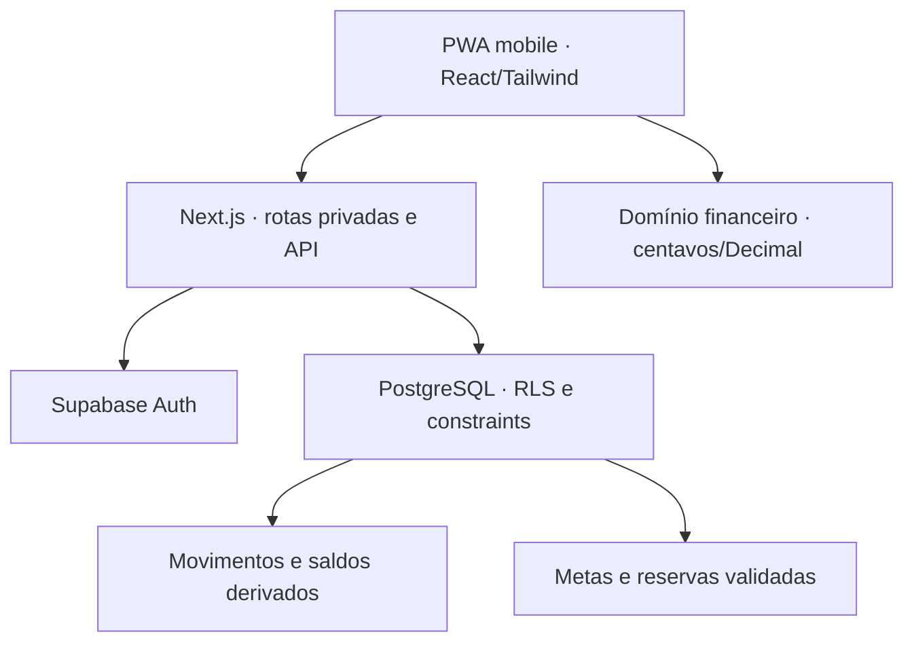

# Gerenciador Financeiro Pessoal — especificação antes da implementação

Versão 1 • 18/10/2026 • nome de interface provisório: Meu Norte.

## 1. Referência e limites da recuperação

A busca de contexto recuperou trechos do chat solicitado “salário bruto ou líquido (1)” e da conversa do Projeto em 18/10/2026. Não recuperou o conteúdo integral nem o arquivo/link do protótipo. Não há alegação de reprodução fiel desse protótipo. A interface proposta aqui é uma base mobile própria, substituível.

Requisitos recuperados do usuário: lançamentos mensais manuais; criar, editar e excluir receitas, despesas e metas; recorrência; aplicações e rendimentos; priorização de metas por data, prazo ou orçamento; relatórios e simulações; light/dark e cores/fundo. A conversa distingue salário disponível de benefícios VA/VR. A arquitetura anterior sugeriu Next.js, TypeScript, Tailwind, Supabase/PostgreSQL, Auth/RLS e Vercel; separação de realizado/projetado e campos para futura importação. Vincular metas a recursos reais evita alocar duas vezes o mesmo dinheiro.

O pedido atual confirma a stack e acrescenta explicitamente CRUD de contas, aportes e investimentos, PWA, testes por fase e compatibilidade com planos gratuitos. Valores pessoais encontrados no contexto NÃO serão usados como dados reais iniciais. Dados de demonstração, se utilizados, serão identificados como fictícios.

## 2. Escopo funcional do MVP

| Módulo            | Comportamento e aceite                                                                                                                                                                                                                                                        |
| ----------------- | ----------------------------------------------------------------------------------------------------------------------------------------------------------------------------------------------------------------------------------------------------------------------------- |
| Identidade        | Cadastro, confirmação de e-mail, login, recuperação/troca de senha e logout via Supabase Auth. Sem senha no banco público. Rotas privadas verificam identidade no servidor.                                                                                                   |
| Contas            | CRUD de conta corrente, dinheiro, benefícios e investimento. Saldo inicial datado; saldo derivado de movimentos realizados. Excluir conta usada exige remover vínculos explicitamente.                                                                                        |
| Lançamentos       | CRUD de receita, despesa, transferência e rendimento realizado; descrição, categoria, conta, data, valor e status previsto/realizado. Filtros de mês, tipo, busca e status. Salário registra líquido, bruto/descontos opcionais.                                              |
| Recorrências      | CRUD de regras mensais, semanais ou anuais, início/fim e pausa. Gerar previsões sob demanda; nunca confirmar pagamento automaticamente. Cada ocorrência é única. Editar regra afeta apenas novas ocorrências; previsões já geradas podem ser editadas/excluídas no histórico. |
| Metas             | CRUD de objetivo, valor, data alvo, prioridade e teto mensal. Progresso apenas por reservas/aportes efetivamente vinculados a contas.                                                                                                                                         |
| Aportes           | CRUD de reservas de valor por meta e conta. Não é nova despesa nem nova receita. Transferir para aplicação é uma transferência distinta. Impedir reservas sobrepostas ou superiores ao saldo disponível.                                                                      |
| Investimentos     | CRUD de configuração por conta de investimento, taxa anual esperada e inflação anual assumida. Aplicar/resgatar por transferência; registrar rendimento positivo/negativo. Rentabilidade realizada e projeção apresentadas separadamente.                                     |
| Planejamento      | Ordenar metas por data alvo, prazo restante ou prioridade/orçamento; distribuir verba mensal sem exceder verba, necessidade ou teto. Mostrar quanto seria necessário por mês e alertar insuficiência. Não criar aportes reais a partir de simulação.                          |
| Relatórios        | Entradas, saídas, saldo do mês, despesas por categoria, evolução mensal, patrimônio, valores reservados, benefícios separados e exportação CSV dos lançamentos filtrados.                                                                                                     |
| Simulador         | Capital inicial, aporte mensal, prazo, taxa anual e inflação editáveis. Série mensal nominal/real, capital aplicado e juros. Premissas explícitas, sem promessa de retorno.                                                                                                   |
| Aparência         | Tema claro/escuro/sistema; paleta e fundos internos (liso, gradiente, pontos). Preferências persistidas por usuário.                                                                                                                                                          |
| PWA               | Manifest, ícones, standalone, service worker e tela offline. Cache somente de recursos públicos; nenhum dado financeiro ou sessão em cache persistente. MVP requer conexão para consultar/alterar dados. Orientação de instalação iOS/Android.                                |
| Importação futura | Modelo de lotes, regras e proveniência; contrato de parser e deduplicação. Nenhum upload, leitura de banco, Open Finance ou categorização automática no MVP.                                                                                                                  |

## 3. Fluxos e experiência mobile

Navegação: visão geral, lançamentos, metas, investimentos, planejamento/relatórios e ajustes. A navegação inferior reúne as ações principais; os demais destinos ficam acessíveis pelo menu. Cabeçalho com competência e ação de novo lançamento. Cards com valores legíveis, indicação de sinal e estado textual além de cor.

Novo usuário: autenticar → criar conta com saldo inicial (ou zero) → registrar receita/despesa → criar meta → reservar valor de uma conta. Para investir: criar conta do tipo investimento → configurar aplicação → transferir valor da conta de origem → registrar rendimentos reais quando conhecidos.

Formulários com labels, teclado decimal, erros em português, estado de salvamento, confirmação de exclusão e foco no primeiro campo. Alvos de toque ≥44px, contraste, foco visível, navegação por teclado, respeitar movimento reduzido e safe area. Estados vazios úteis, erros de rede e atualização explícita. Nenhum dado fictício em conta autenticada.

## 4. Arquitetura

Monólito modular Next.js App Router. TypeScript estrito e Tailwind; componentes React interativos; domínio financeiro puro separado da interface. Supabase Auth com cookies via @supabase/ssr, proxy de atualização de sessão e validação no servidor. Route handlers com autenticação, validação Zod e proteção de origem para escritas. Acesso HTTP à Data API evita pool de conexões TCP em funções Vercel.

Sem microserviços, filas, IA, cron pago ou sincronização bancária. Recorrências geradas sob ação do usuário, com UPSERT/idempotência no banco. Páginas privadas e APIs no-store; service worker não armazena HTML autenticado, JSON, APIs ou Supabase. Modo demonstração em /demo usa estado somente em memória e é completamente separado da autenticação.

Destino solicitado: Vercel + Supabase. Não substituir Next.js por runtime de Sites/Vinext/Cloudflare. Entregar código e instruções Vercel; publicar em conta externa requer acesso configurado. Sem credenciais Supabase nesta sessão, integração real de e-mail e ponta a ponta será marcada como pendente, sem simular aprovação desse gate.

## 5. Modelo relacional

Todos os IDs são UUID. Toda tabela de usuário possui user_id com RLS e índice. Chaves estrangeiras compostas (user_id, id) impedem relacionar recursos de usuários diferentes, inclusive por chamada direta à API. Tabelas públicas sem dados de visitantes anônimos.

| Tabela               | Campos principais                                                                                                                                                                                                                       | Relacionamentos                             |
| -------------------- | --------------------------------------------------------------------------------------------------------------------------------------------------------------------------------------------------------------------------------------- | ------------------------------------------- |
| profiles             | user_id PK, display_name, theme, accent, background                                                                                                                                                                                     | auth.users 1:1                              |
| accounts             | id, user_id, name, kind, opening_cents, opening_date                                                                                                                                                                                    | auth.users 1:N; UNIQUE(user_id,id)          |
| goals                | id, user_id, name, target_cents, target_date, priority, monthly_budget_cents                                                                                                                                                            | auth.users 1:N                              |
| contributions        | id, user_id, goal_id, account_id, amount_cents, date, note                                                                                                                                                                              | goals N:1; accounts N:1                     |
| investments          | id, user_id, account_id UNIQUE, name, annual_rate, inflation_rate                                                                                                                                                                       | accounts 1:1 (tipo investment)              |
| recurrences          | id, user_id, kind, description, amount_cents, source_account_id, target_account_id, category, frequency, start_date, end_date, active                                                                                                   | accounts N:1; gera transactions             |
| transactions         | id, user_id, kind, description, amount_cents, date, status, source_account_id, target_account_id, category, gross_cents, deductions_cents, recurrence_id, occurrence_date, source, external_id, import_batch_id, categorization_rule_id | accounts N:1 em cada ponta; recurrences N:1 |
| import_batches       | id, user_id, filename, fingerprint, status                                                                                                                                                                                              | reservado para importação futura            |
| categorization_rules | id, user_id, pattern, category, priority, active                                                                                                                                                                                        | reservado para categorização futura         |

Índices: transactions(user_id,date DESC), cada FK de conta; contributions(user_id,account_id)/(user_id,goal_id); recurrences(user_id,active). UNIQUE(recurrence_id,occurrence_date) impede duplicação; UNIQUE(user_id,source,external_id) com external_id não nulo prepara deduplicação de importação. Deletes RESTRICT preservam relações financeiras. Excluir um lançamento de recorrência mantém a chave da ocorrência em um registro cancelado para não recriar silenciosamente (status cancelled); consulta normal oculta cancelados.

Saldos não são colunas mutáveis. Saldo = saldo inicial + entradas realizadas − saídas realizadas até a data de corte. Transferências usam um único registro com origem/destino, portanto são atômicas e preservam patrimônio. Conta investimento é um ativo; sua configuração não duplica seu valor patrimonial.

## 6. Regras de negócio

### Dinheiro e datas

BRL no MVP; valores inteiros de centavos no PostgreSQL bigint e limites de segurança para transporte JSON. Limite por valor/saldo de conta: 999.999.999.999 centavos. Agregados e projeções usam até Number.MAX_SAFE_INTEGER centavos e falham explicitamente se ultrapassarem esse teto. Nenhum parseFloat para moeda; parser brasileiro estrito e Decimal para juros e arredondamentos, HALF_UP no centavo. Taxas anuais decimais ex.: 0,10 = 10%. Datas de competência em YYYY-MM-DD, sem conversão via UTC. “Hoje” calculado em America/Sao_Paulo. Timestamp apenas para auditoria técnica; não substitui competência.

Renda disponível usa líquido efetivamente informado. Bruto e descontos opcionais devem satisfazer bruto − descontos = líquido, sem cálculo tributário automático. VA/VR entra em conta benefício, aparece separado e não compõe verba livre para metas; não pode ser transferido para conta de dinheiro/investimento. Gasto em benefício também é separado nos relatórios de caixa livre.

Receita: destino obrigatório, origem vazia. Despesa: origem obrigatória, destino vazio. Transferência: duas contas diferentes e mesmo tipo de restrição (benefício só para benefício). Rendimento: apenas conta investimento; valor pode ser negativo para perdas. Demais valores positivos. Realizado não pode ser futuro; previsto não altera saldo. Datas anteriores à abertura da conta são rejeitadas. Alterar/excluir movimento não pode deixar reservas existentes sem cobertura. Conta corrente/dinheiro pode ter saldo devedor (evidenciado), benefício/investimento não pode ficar negativo.

### Metas e aportes

Aporte é reserva de recurso existente, não saída de caixa. Recursos reservados não entram em saldo livre para nova meta. Soma por conta ≤ max(saldo atual,0); soma por meta ≤ alvo. Não se reserva benefício. Bloqueio transacional por usuário serializa gravações, inclusive chamadas concorrentes. Reduzir alvo/saldo inicial, remover receita ou resgatar recursos reservados exige antes ajustar reservas. Não redistribuir automaticamente reservas entre contas.

Planejamento usa meses inclusivos (mês atual conta como uma parcela) até data alvo; prazo vencido sinalizado. Estratégia data: mais próxima primeiro; prazo: menor prazo restante primeiro (equivale à data em um mesmo dia-base; mantida para clareza da UX); orçamento: prioridade numérica, depois data. Distribuir min(verba restante, necessário/mês, teto mensal configurado). Mostrar sobra e déficit; não confundir sugestão com aporte realizado.

### Investimentos e rentabilidade

Saldo de investimento é saldo de conta, incluindo transferências e rendimentos realizados. Compras/aplicações e resgates são transferências, não receita/despesa. Rendimento é valor manual observado; sem cotações automáticas. Rentabilidade nominal realizada desde a abertura: Modified Dietz = ganho / (capital inicial + soma de fluxos ponderados pelo tempo). Fluxos positivos para aportes, negativos para resgates; ganho = saldo final − inicial − fluxos líquidos. Quando denominador ≤0 ou período sem duração, mostrar “indisponível”, nunca taxa infinita.

Rentabilidade real = (1 + retorno nominal) / (1 + inflação do período) − 1; inflação anual assumida capitalizada pela duração em dias/365. Rendimento REAL significa descontado da inflação assumida; rendimento REALIZADO significa efetivamente registrado. A UI distingue ambos. Impostos e taxas devem ser lançados manualmente como despesas da conta investimento; retornos realizados as incorporam. Não presumir isenção tributária nem taxas líquidas.

Projeção: taxa mensal equivalente (1 + taxa anual)^(1/12) − 1; aportes no fim do mês; VF_m = VF_(m−1)×(1+i_m)+aporte. Valor real deflacionado por (1+inflação anual)^(m/12). Não atualizar saldo real ou meta com projeção. Premissas configuráveis; sem recomendação de produto ou promessa de retorno.

### Recorrências

Data mensal ancorada no dia original, limitada ao último dia do mês (31/jan→28/fev→31/mar); anual em 29/fev→28/fev em ano comum, voltando a 29 em bissexto. Semanal a cada sete dias. Geração cobre uma janela informada de no máximo 12 meses, respeita início/fim e regra ativa; gera status planned. Confirmação do realizado é sempre explícita. Duplicação, cancelamento e reexecução testados no PostgreSQL.

## 7. Segurança e operação

RLS SELECT/INSERT/UPDATE/DELETE com auth.uid() = user_id; revogar privilégios anon. user_id atribuído pelo servidor e conferido no banco. Funções expostas são SECURITY INVOKER, search_path fixo; validações de integridade por triggers não confiam no navegador. Nenhuma service_role key necessária. CSRF por comparação Origin com a origem da requisição (API), cookies same-site, sessão validada em cada rota. Cabeçalhos de proteção, CSP compatível com Next.js/Supabase, erros sanitizados, sem logs de tokens ou payloads financeiros. Dados de usuário não ficam em localStorage/IndexedDB. Exportação CSV escapa fórmulas de planilha.

Plano gratuito: evitar polling, realtime e cron; leituras paginadas via Data API; recorrência sob demanda e agregação em memória no volume pessoal. Paginar todo o histórico, sem truncar em 1.000 registros. Consultas sempre por usuário, índices para data e FKs. Importação futura deverá limitar tamanho de arquivo/linhas, normalizar datas/valores e revisar antes de confirmar.

Vercel Hobby é destinado a uso pessoal/não comercial; Supabase Free tem cotas e pode pausar projetos inativos. Não garantir gratuidade irrestrita ou SLA. Conferir cotas no painel antes de publicar; exportar dados e manter migrações versionadas. E-mail de confirmação/recuperação depende da configuração e das cotas de Auth/SMTP do projeto.

## 8. Plano incremental e gates

| Fase | Entrega                                                          | Validação antes de avançar                                                                                                                                                  |
| ---- | ---------------------------------------------------------------- | --------------------------------------------------------------------------------------------------------------------------------------------------------------------------- |
| 0    | Este documento: escopo, arquitetura, modelo, regras e decisões   | Cobertura dos requisitos e hipóteses declaradas; documento escrito antes de código                                                                                          |
| 1    | Domínio de moeda, datas, recorrência, projeções e plano de metas | Unitários com centavos, arredondamento, bissexto, mês curto, juros, inflação e sobrealocação                                                                                |
| 2    | Migração PostgreSQL, RLS, contas/movimentos/reservas             | Banco PostgreSQL embutido: duas identidades, anon, FKs cruzadas, transferências, cobertura de reservas, exclusões e idempotência                                            |
| 3    | Next.js, Auth, APIs, CRUD e fluxos mobile                        | TypeScript/build; testes de componentes e contratos. Smoke Auth real pendente até conectar Supabase                                                                         |
| 4    | Relatórios, simulações, recorrências e aparência                 | Cálculos conciliados com fixtures; CSV seguro; formulários validados                                                                                                        |
| 5    | PWA e entrega                                                    | Manifest/ícones/SW validados; build produção e verificação de não cache de dados. Instalação em iPhone/Android e e-mails em ambiente publicado permanecem gate de liberação |

A implementação local pode prosseguir pelos gates automatizados independentes de serviços externos; o MVP não será declarado validado em produção antes de confirmar Auth, RLS e CRUD contra o Supabase de destino. Defeitos de fase são corrigidos antes de avançar. Registrar evidências em VALIDACAO.md.

## 9. Decisões e evolução

ADRs: monólito para manutenção simples; centavos para exatidão; saldo derivado para reconciliação; aporte como reserva para evitar dupla contagem; transferências atômicas; RLS + FKs compostas para isolamento; online-first para reduzir risco de conflito e exposição de dados; geração sob demanda para evitar dependência de cron pago; BRL e entrada manual no MVP.

Fora do MVP: Open Finance, leitura de extrato, categorização automática, OCR, cotação de ativos, cálculo fiscal/salário automático, múltiplas moedas, compartilhamento familiar e notificações push/e-mail financeiras. Notificações foram sugestão anterior do assistente, não requisito confirmado neste pedido. Preparação para importação: interface de parser retorna candidato normalizado, external_id determinístico, source e lote; revisão e confirmação transacional antes de inserir no ledger.

## 10. Fontes técnicas consultadas

- Next.js instalação e PWA: https://nextjs.org/docs/app/getting-started/installation e https://nextjs.org/docs/app/guides/progressive-web-apps
- Supabase SSR: https://supabase.com/docs/guides/auth/server-side/creating-a-client?framework=nextjs
- Supabase RLS: https://supabase.com/docs/guides/database/postgres/row-level-security
- Planos: https://supabase.com/pricing e https://vercel.com/docs/plans/hobby

Detalhes de versão serão fixados em package-lock.json. As fontes suportam padrões técnicos, não constituem decisões pessoais recuperadas.
