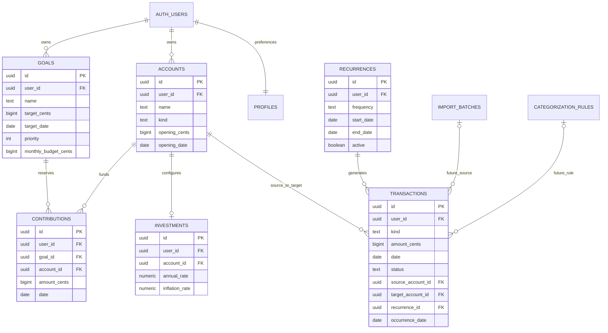

# Modelo relacional

A migração SQL é a fonte executável do modelo. Todas as tabelas têm dono e RLS. Chaves estrangeiras de recursos incluem `(user_id, id)`; não basta conhecer um UUID para relacionar objetos de outro usuário.

## Contabilidade dos saldos

`Saldo(conta, corte) = saldo_inicial + entradas_realizadas − saídas_realizadas`.

Um movimento tem origem e/ou destino conforme o tipo. Transferências têm as duas pontas no mesmo registro. Rendimento usa destino investimento e aceita valor negativo. Previsões/cancelamentos não alteram saldos. Saldos iniciais ficam antes dos movimentos do histórico e não são receitas do período.

`Patrimônio = soma dos saldos das contas exceto benefícios`.

`Livre para novos planos = patrimônio − reservas das metas`.

`Liquidez livre = contas corrente/dinheiro − reservas nessas contas`.

`Benefícios = saldos VA/VR em separado`.

As reservas de uma conta de investimento não garantem liquidez de resgate: são apenas alocações de valores. Características de carência, cotação, liquidez e risco de produtos específicos não são modeladas neste MVP.

## Unicidade e exclusões

- `(recurrence_id, occurrence_date)` único. A API mantém tombstone `cancelled` em ocorrências excluídas.
- `(user_id, source, external_id)` único quando existe external_id.
- Uma configuração por conta de investimento.
- Remover uma configuração de investimento não remove a conta nem o dinheiro nela.
- Remover regra de recorrência desvincula o histórico e mantém os movimentos; não apaga valores realizados.
- Conta/meta vinculadas usam RESTRICT: remover reservas e vínculos primeiro.

## Concorrência

Cada escrita financeira adquire um advisory transaction lock por user_id; validações de cobertura e limites ocorrem dentro da transação. Isso serializa as verificações por usuário. A migração mantém RLS ativa para funções SECURITY INVOKER. O lock foi executado nos testes locais; disputa entre duas conexões remotas precisa do gate de homologação. Em um deadlock, o PostgreSQL reverte uma operação; o cliente deve repetir a ação após recarregar dados.

## Preparação para importação

Tabelas de lote/regra e campos `source`, `external_id`, `import_batch_id`, `categorization_rule_id` estão presentes. `src/lib/import-contract.ts` define a interface futura do parser. Usuários autenticados têm somente SELECT nessas duas tabelas reservadas; não existe rota de upload/categorização no MVP. A implementação futura exigirá migração que conceda apenas os novos acessos necessários, revisão de duplicatas e confirmação antes do ledger.
